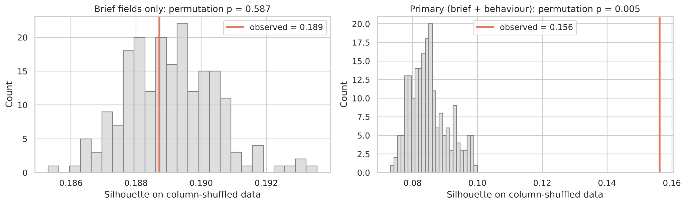
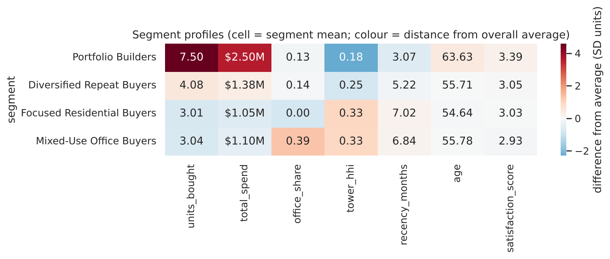

# Buyer Segmentation & Investment Profiling for Real Estate Market Intelligence

Machine-learning segmentation of Parcl Co. Limited's property buyers, with a live analytics dashboard and a research paper.

**Live dashboard:** `https://<your-app>.streamlit.app`  ·  **Paper:** [`reports/research_paper.pdf`](reports/research_paper.pdf)  ·  **Notebook:** [`notebooks/buyer_segmentation_analysis.ipynb`](notebooks/buyer_segmentation_analysis.ipynb)

---

## Problem

Parcl markets to every buyer the same way. That wastes marketing spend, produces generic property recommendations and misses investors. This project uses clustering to answer three questions:

1. Do Parcl's clients form distinct segments?
2. Are those segments reliable, meaning stable and better than chance?
3. How do segments differ in investment purpose, geography, financing and demographics, and what should Parcl do?

## Key findings

| | |
|---|---|
| **Client attributes are nearly independent** | Only 1 of 28 attribute pairs is significantly associated (client type × age, Cramér's V = 0.16) |
| **Brief fields alone give no real segments** | Clustering age, satisfaction and categorical fields produces stable groups that are **no better than shuffled data** (permutation p = 0.587). It just splits age × satisfaction into quadrants. |
| **Purchase behaviour gives real segments** | Adding transaction features gives 4 segments that **beat the shuffled baseline** (silhouette 0.156 vs 0.085, p = 0.005) and agree across K-Means and Hierarchical clustering (ARI = 0.82) |
| **Brief's C1–C4 segments** | None supported as described. Company representatives are ~8 years younger, but companies do not buy more units |

### The four segments

| Segment | Share | Profile | Recommended action |
|---|---|---|---|
| **Portfolio Builders** | 2.2% | 5–13 units (avg 7.5), $2.5M spend, spread across towers, oldest and most satisfied | Relationship managers, early access, bulk pricing |
| **Diversified Repeat Buyers** | 50.2% | ~4 units across towers, 85% bought in both years | Loyalty and referral programme, cross-tower bundles |
| **Focused Residential Buyers** | 28.1% | 3 apartments, no offices, longest since last purchase | Re-engagement, residential lifestyle messaging |
| **Mixed-Use Office Buyers** | 19.6% | ~3 units, 39% offices, highest unit price | Commercial listings; test before scaling (least stable) |

<p align="center"></p>
<p align="center"></p>

## Method

1. **Cleaning.** Parse 3 mixed date-of-birth formats and text prices, normalise labels, check duplicates and missing values, remove names (PII). 9 validation checks.
2. **Feature engineering.** Join the property table to build client-level behaviour: units bought, total spend, office share, tower concentration (Herfindahl index), recency, and a peer-relative **premium index**.
3. **Encoding and scaling.** Binary fields 0/1, nominal referral channel one-hot, numerics standardised (StandardScaler; MinMaxScaler compared). Region is used for geography, not clustering, because it is nested in country.
4. **Clustering.** K-Means and Ward hierarchical clustering, k = 2–10; Elbow, Silhouette, Davies–Bouldin, Calinski–Harabasz. K-Prototypes as a mixed-data robustness check.
5. **Validation beyond the brief:**
   - permutation null (200 column-shuffled datasets)
   - gap statistic (Tibshirani et al., 2001)
   - bootstrap cluster-wise stability (Hennig, 2007)
6. **Interpretation.** Segment profiles, lift, **location quotients** for geography (from regional economics) with bootstrap CIs, and 13 pre-registered hypotheses with Benjamini–Hochberg correction.

## Dashboard

An infographic-style dashboard built around the four pages the brief requires, plus a validation page. Every page responds to the brief's four sidebar filters: **country → region** (cascading), **acquisition purpose** and **client type**. A filter left empty means "all".

| Page | Brief requirement | What it shows |
|---|---|---|
| 📊 Buyer Segmentation Overview | Displays cluster distribution | Colour-coded segment cards, a 100-square waffle chart of the cluster distribution, share of clients vs share of spend, and a 2-D map of buyers |
| 💼 Investor Behavior Dashboard | Investment patterns by cluster | Investment, loan, office and repeat-purchase bars per segment; units vs spend bubbles; home vs investment mix; monthly purchases; apartments vs offices |
| 🌍 Geographic Buyer Analysis | Maps buyer segments by region | Location-quotient world map and US-state map, segment mix by region, and statistically clear concentrations |
| 🔍 Segment Insights Panel | Descriptive statistics per cluster | Persona card with recommended actions, stats vs the average buyer, demographic donuts, a descriptive-statistics table, CSV export, and the brief's C1–C4 vs evidence |
| ✅ Model Validation | Supports the paper | How-this-works flow infographic, our segments vs shuffled data, bootstrap stability, Elbow, Silhouette and the hypothesis table |

**Also on every page:**
- **Buyer Galaxy:** a rotatable 3D view of all 2,000 buyers, with a 2D toggle for precise reading. The axes are a PCA projection of the clustering features, built by `scripts/build_embedding.py` from the frozen model.
- **Action titles:** headlines that state the finding. They are generated from the data (`src/insights.py`), so they stay correct when filters change.
- **Counts and uncertainty:** every rate shows "k of n" and a 95% Wilson range. Segments under 100 buyers get a small-sample badge (`src/uncertainty.py`).
- **Icon arrays:** "about 36 in 100 Portfolio Builders bought to invest".
- **Provenance footer:** model file hash, seed and data checksums. Tags mark each headline as *Observed in data* or *Model output*.

## Repository structure

```
├── app/streamlit_app.py          # dashboard (previous version: streamlit_app_v1.py)
├── data/raw/                     # original CSVs + SHA-256 checksums
├── data/processed/               # cleaned data and client_segments.csv (generated)
├── docs/decision_log.md          # methodological decisions and rationale
├── notebooks/buyer_segmentation_analysis.ipynb
├── reports/research_paper.pdf    # paper (also .docx)
├── reports/figures/              # all figures (generated)
├── results/                      # metrics.json and result tables (generated)
├── src/                          # data, features, clustering, profiling modules
├── scripts/build_embedding.py    # 3D coordinates (reads the frozen model)
├── src/insights.py, src/uncertainty.py  # action titles, 95% ranges
├── tests/                        # 15 unit tests
└── run_pipeline.py               # regenerates every result
```

## Run locally

```bash
pip install -r requirements.txt
python run_pipeline.py              # ~1 minute, seed 42
python scripts/build_embedding.py   # 3D coordinates for the Buyer Galaxy
pytest -q                           # 15 tests
streamlit run app/streamlit_app.py
```

## Data

`clients.csv` (2,000 clients × 12 fields) and `properties.csv` (10,000 listings × 9 fields), provided by Unified Mentor for the Parcl project. 7,305 sold units link to clients via `client_ref`. Names are dropped during cleaning and never appear in outputs.

## Limitations

- The attributes are close to independent, which is typical of synthetic data, so findings may not generalise.
- Segments overlap (the gap statistic prefers k = 1), so use them as targeting tendencies, not hard boundaries.
- Portfolio Builders has only 44 clients.
- There is no income field.
- All results are associational: they show which segments tend to have a trait, not which will respond to a campaign.

## References

- Tibshirani, Walther & Hastie (2001). Estimating the number of clusters via the gap statistic. *JRSS-B* 63(2).
- Monti et al. (2003). Consensus clustering. *Machine Learning* 52.
- Hennig (2007). Cluster-wise assessment of cluster stability. *CSDA* 52.
- Huang (1998). Extensions to the k-means algorithm for categorical values. *DMKD* 2.

## Author

**Uttara Gairola**, Data Science Internship, Unified Mentor. Licensed under MIT.
